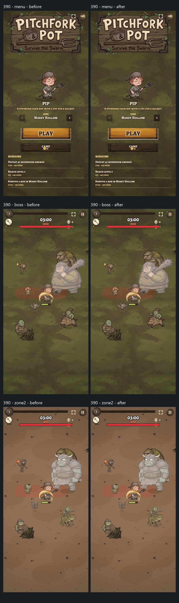
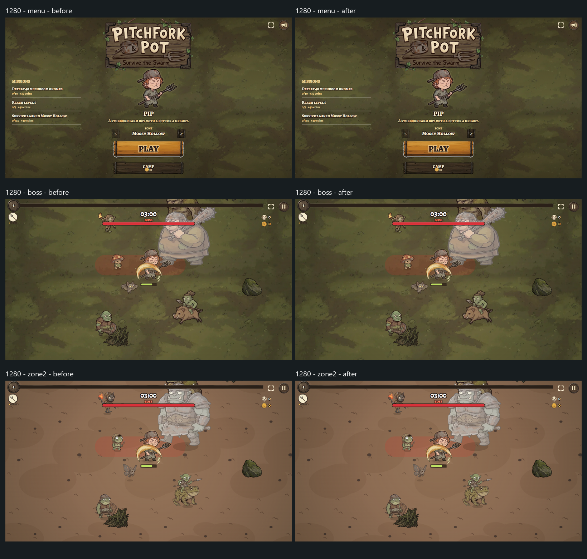

# Codex atlas — vòng 4

Nhánh `codex/atlas`, tạo từ `folk-version` tại `9763597`. Báo cáo ngày 14/10/2026.

Atlas và tải hai đợt đã hoàn tất. Trên Fast 4G, thời điểm hero + grub/bat + jab có thể vẽ bằng art thật giảm từ 9–12 giây xuống 5,3–5,7 giây. Boot chỉ ẩn khi nhóm tài nguyên mở đầu đã hoàn tất. Nhánh giữ nén **lossless**, vì brief yêu cầu giữ nguyên pixel; dung lượng tải tổng và dung lượng build tăng, chưa đạt mục tiêu dưới 5 MB trong DESIGN.md.

## Thay đổi

- `tools/pack-atlas.mjs:52`, `package.json`: tự đóng 18 clip và 1 hero thành 19 `atlas.webp` ở prebuild; gutter 2 px, cạnh tối đa 4096, SHA-256 xác định nguồn/output. Build sau dùng cache; `npm run pack:atlas -- --verify` kiểm tra lại pixel. Tất cả alpha và RGB ở pixel có alpha > 0 khớp ảnh gốc. Không đổi ảnh rời; JSON chỉ thêm trường `atlas`, giữ nguyên frame order/fps/cx/foot/k.
- `src/game/perf/frames.ts:101`: đọc rect và dùng ảnh atlas chung, kiểm tra kích thước/biên rect. Giữ phép thu nhỏ từng frame cho sprite nhỏ để khớp kích thước làm tròn cũ. Atlas thiếu/hỏng thì tải ảnh rời. Vẫn có white hit-flash mask và fallback canvas khi thiếu `createImageBitmap`.
- `src/game/clips.ts:35`: chia sẻ promise và texture đã chuẩn bị; clip Zone 2 tạo khi vẽ lần đầu nhận cache ngay, tránh một frame stand-in.
- `src/game/perf/loading.ts:35`: ưu tiên hero, jab, grub/bat của vùng đang chọn; tải nhóm critical tối đa 6 job, nhóm nền 1 job. Các quái còn lại theo thứ tự wolf, beetle, brute, shroom, boss rồi effects. Clip của vùng chưa chọn chưa tải.
- `src/engine/assets.ts:16`, `src/main.ts:20`: chờ font, UI/HUD, props/pickups, ground vùng, hero, quái mở đầu, jab và vũ khí ban đầu trước boot/Poki loadingFinished. Nhóm sau bắt đầu 50 ms sau khi mở màn hình. Asset đã decode mới được đánh dấu ready; có timeout để không treo boot khi tài nguyên lỗi.
- `src/main.ts:144`, `src/game/perf/requirements.ts:6`: đổi vùng hoặc lựa chọn kỹ năng sớm có thể ưu tiên art chưa xong, dùng boot hiện có và dừng vòng update trong lúc chờ. Token tránh đổi vùng nhanh mở boot quá sớm. Offer icon/player selection là hook qua Assets; không sửa game/model/config.
- `src/game/hero.ts:44`: chuẩn bị 4 glow mở đầu thay vì cả 36; 32 glow còn lại làm từng frame lúc idle, có lazy fallback. Padding 10, blur 4, màu và alpha cũ được giữ. White/glow canvas dùng software context để tránh readback GPU lớn. Vẽ cảnh đầu dưới boot để làm nóng cache view có sẵn; không update model.

## Số đo trước/sau

Chrome 154, GTX 1070/ANGLE D3D11, production preview. Fresh browser context cho từng ca; cache tắt, Fast 4G (8,1 Mbps download, 1,35 Mbps upload, latency 165 ms), CPU throttle 4×. Điện thoại 390×844 DPR 2 (canvas áp cap hiện có); desktop 1280×720 DPR 1. Mỗi ca một lần, không phải p95 thiết bị thật. Chặn Poki CDN ở cả hai bản để đo tài nguyên cùng origin ổn định.

Baseline là `9763597`; chỉ thêm debug expose `__ds` trong bản QA baseline, không đổi loader/render. Run đầu, HP cao trong fixture để tránh chết. Tổng request/KB tính đến khi art của vùng và effects tải xong + mạng idle, không phải tổng của tất cả vùng. KiB gồm HTTP encodedDataLength, không bao gồm CDN bị chặn.

| Vùng / viewport | Art mở đầu trước → sau (ms) | Request trước → sau | KiB trước → sau |
| --- | ---: | ---: | ---: |
| Zone 1 / 390×844 | 8951,5 → 5577,8 | 294 → 94 | 3079,2 → 7743,7 |
| Zone 1 / 1280×720 | 9094,2 → 5710,3 | 294 → 94 | 3079,2 → 7743,7 |
| Zone 2 / 390×844 | 12176,6 → 5333,2 | 369 → 93 | 4179,6 → 7864,8 |
| Zone 2 / 1280×720 | 11823,8 → 5405,1 | 369 → 93 | 4179,6 → 7864,8 |

Baseline ẩn boot sau 1,5–1,8 giây khi animation chưa sẵn sàng. Bản mới ẩn boot sau 5,3–5,7 giây với art hoàn tất, khoảng 61–62 request / 2877–2896 KiB. Thời gian nhìn loading screen dài hơn, thời gian nhìn art thật ngắn hơn 37–56%. Các ca đo bản mới ghi **0 lần hero/enemy fallback**; baseline có 46–186 lần hero và 623–5199 lần enemy fallback trong cửa sổ đo.

Glow ở thời điểm mở boot: 4/36. Vẫn có long task 137–195 ms trong giây đầu trên CPU throttle 4×; không khẳng định đã xóa mọi hitch. Chi phí lạnh còn nằm ở cache/view và canvas của Chrome, cần profiling thiết bị thật nếu muốn giảm tiếp.

## Kiểm tra và ảnh

- `npm run build`: qua TypeScript strict + Vite; prebuild dùng cache ổn định.
- `node --experimental-strip-types --no-warnings tools/test-model.ts`: 27 kiểm tra, **all passed**.
- `node tools/pack-atlas.mjs --verify`: cả 19 atlas qua kiểm tra pixel. Đối chiếu JSON sau khi bỏ `atlas`, ảnh rời và model/config/game với baseline: không thay đổi. `git diff --check`: qua.
- Smoke: boot với SDK stub thông báo loadingFinished đúng 1 lần; thiếu createImageBitmap/requestIdleCallback; toàn bộ atlas bị chặn; rect hero lỗi; save ptero cũ với spit; viewport 0×0. Đổi Zone 2 trên Fast 4G, model/view clock dừng lúc chờ, art grub/bat có ngay khi tạo clip; đổi vùng nhanh; offer spit sớm; bat tại giây 50. Không có lỗi JavaScript.
- Chạy đủ phút đầu riêng từng vùng ở 390×844, cache tắt, Fast 4G, CPU bình thường: Zone 1 tới 61,17 giây và Zone 2 tới 61,28 giây model; cả hai **0 hero fallback, 0 enemy fallback, 0 lỗi JavaScript**, có grub và bat thực sự xuất hiện. Fixture tăng HP để tránh chết và tự chọn offer. Không tính lượt này vào bảng đo loading CPU 4× ở trên.
- Ảnh tĩnh menu, boss tại 3:00, Zone 2, white flash ở 1280×720 và 390×844. Fixture cố định seed/clock/camera, cùng font, đặt lại canvas state trước mỗi cảnh. Bố cục, kích thước, anchor và art khớp; PNG browser không byte-identical: RGB MAE 0,0025–0,0030 / 255 ở run/flash và 0,118–0,131 / 255 ở menu. Chênh lệch raster/alpha/smoothing rất nhỏ, không có thay đổi layout hoặc nội dung ảnh. Không dùng kết quả PNG để tuyên bố tất cả pixel màn hình tuyệt đối giống nhau.

Ảnh ghép chỉ thu nhỏ để tiện xem; cột trái trước, phải sau; lần lượt menu, boss, Zone 2:

Ảnh PNG gốc, trace JSON và script Puppeteer ở thư mục giao trên PC làm việc: `C:/Users/PC/Documents/Codex/2026-10-13/te/outputs/codex-atlas/`. Script QA nằm ngoài repo; không sửa test/balance tool hiện có.

## Requests for Claude

1. Chốt ưu tiên giữa pixel lossless và mục tiêu build < 5 MB. Bản đang gửi: baseline 4,251 MiB → **13,922 MiB**, vì atlas lossless và vẫn có ảnh rời để fallback. Thử nghiệm tách biệt WebP quality 88 + bỏ bản sao ảnh rời khỏi dist cho kết quả 4,290 MiB, khoảng 3073/3365 KiB tải mỗi vùng, nhưng có sai khác màu nhỏ; chưa đưa cách nén đó vào nhánh vì không đáp ứng pixel tuyệt đối. Nếu chọn hướng này, giữ ảnh rời trong public cho dev pipeline và thêm bước prune dist sau khi atlas đã được kiểm tra.
2. Không cần hook game/model/config để tích hợp. Kiểm tra Poki CDN thật và điện thoại thật khi review; phép đo hiện tại dùng mạng/CPU giả lập trên desktop, SDK lifecycle có stub riêng.
